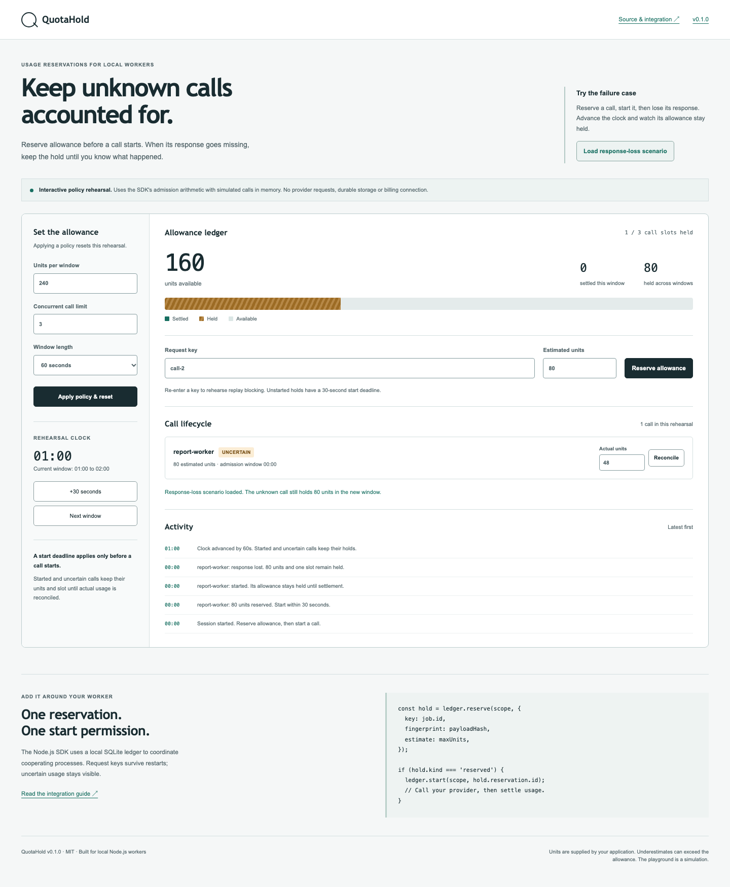

# QuotaHold

**Reserve usage before a call. Keep unknown outcomes accounted for.**

A small Node.js library for AI workers, API jobs and local automation that share an allowance. QuotaHold coordinates reservations in SQLite, gives each request one start permission, and reconciles actual usage when a receipt arrives.

[](https://github.com/ABRJrocks/quotahold/actions/workflows/checks.yml)
[](https://nodejs.org/)
[](LICENSE)

[**Download the offline playground**](https://github.com/ABRJrocks/quotahold/releases/download/v0.1.0/quotahold-playground.html) · [Hosted playground](https://abrjrocks.github.io/quotahold/) · [Download v0.1.0](https://github.com/ABRJrocks/quotahold/releases/tag/v0.1.0) · [Integration guide](docs/integration.md) · [Lifecycle contract](docs/contract.md)



Download `quotahold-playground.html` from the release and open it directly in a browser. The self-contained version needs no server or installation. The hosted version is deployed by the verification workflow.

## The problem it handles

A worker checks the remaining allowance and sends a request. Meanwhile, other workers pass the same check. A timeout then hides whether one request consumed usage. Retrying or refunding every timed-out request can admit more work than intended.

QuotaHold counts reserved and started work before admitting another call. A started call keeps its reservation after a crash, timeout or quota-window change. Recovery explicitly reconciles actual usage with a receipt. Unused reservations may expire, but a start deadline never refunds an already-started call.

- **Atomic admission across local processes** with allowance and concurrent-call limits.
- **Durable request keys and payload fingerprints**, including conflicting replay detection.
- **One start permission per reservation**, committed before your provider call.
- **Conservative unknown-outcome recovery**, with notes required for uncertain-call reconciliation.
- **Actual usage and underestimation visibility**, rather than silently clamping an overrun.
- **A TypeScript-friendly API, JSON CLI and working HTTP example.**
- **Zero npm runtime dependencies**, using Node's built-in SQLite API.

This is an embedded component for cooperating workers on one machine. It does not proxy providers, estimate tokens, implement authentication or reconcile invoices. For a full gateway, evaluate established tools such as LiteLLM. [Research and alternatives](docs/research.md).

## Install

Requires Node **24.15+**. The initial package is distributed through GitHub Releases, not the npm registry.

```sh
npm install https://github.com/ABRJrocks/quotahold/releases/download/v0.1.0/quotahold-0.1.0.tgz
```

## Put it around a worker

Your application supplies the estimate and reads actual usage from its provider response. Units can represent tokens, credits or another nonnegative integer measure. Keep one consistent definition per scope.

```js
import { createHash } from 'node:crypto';
import { Ledger, runCall } from 'quotahold';

// Create once during application setup. It refuses to overwrite existing files.
const setup = Ledger.create('./usage.db');
setup.configure('support-agent', {
  capacity: 100_000,
  periodSeconds: 3600,
  maxInflight: 4,
  unit: 'tokens',
});
setup.close();

const ledger = new Ledger('./usage.db');
const payload = { task: 'classify-ticket', ticketId: 'ticket-42' };
const fingerprint = createHash('sha256')
  .update(JSON.stringify(payload))
  .digest('hex');

try {
  const result = await runCall(ledger, 'support-agent', {
    key: 'ticket-42-attempt-1',
    fingerprint,
    estimate: 2_000,
  }, async () => {
    // Call your existing provider adapter here.
    const response = await provider.classify(payload);
    return {
      value: response.output,
      actual: response.totalUnits,
      receipt: response.requestId,
    };
  });
  console.log(result.value);
} finally {
  ledger.close();
}
```

`provider` is your application adapter, not an API bundled with QuotaHold. [`examples/http-worker.js`](examples/http-worker.js) is a fully runnable example using a real loopback HTTP server, with injected response loss, replay blocking and recovery assertions:

```sh
node node_modules/quotahold/examples/http-worker.js
```

`runCall` never automatically retries. It rejects a replay before calling the callback. Store business results in your application if retries need to return the previous result. If the callback or usage reconciliation fails after start, the reservation remains held and is marked uncertain when the ledger is available.

## Recover a missing response

```js
const unknown = ledger.list('support-agent').filter(
  hold => hold.state === 'uncertain' || hold.state === 'started'
);

// After confirming usage in your provider or application records:
ledger.settle('support-agent', unknown[0].id, {
  actual: 1_240,
  receipt: 'provider-request-42',
  note: 'Confirmed by provider usage records',
});
```

A process crash can leave a call in `started`; it still counts. Confirm usage before settling. To record a confirmed zero-usage failure, settle with `actual: 0` and an explanatory receipt/note. Started calls cannot be cancelled. This conservative behavior can block work until an operator resolves it.

## Lifecycle

```text
reserved ── start ──> started ── settle ──> settled
    │                    │
    │                    └── unknown outcome ──> uncertain ── settle ──> settled
    ├── cancel ──> cancelled
    └── unused start deadline ──> expired
```

Only `reserved` holds can expire or cancel. Reserved, started and uncertain holds all consume a concurrent-call slot and their estimated units. See the [exact contract](docs/contract.md), including period rollover and idempotency behavior.

## CLI

Commands print JSON. A policy denial exits **3**, invalid input or storage failure exits **2**, and success exits **0**.

```sh
npx --no-install quotahold init usage.db
npx --no-install quotahold configure usage.db --scope assistant --input node_modules/quotahold/examples/policy.json
npx --no-install quotahold reserve usage.db --scope assistant --input node_modules/quotahold/examples/reservation.json
npx --no-install quotahold status usage.db --scope assistant
npx --no-install quotahold list usage.db --scope assistant --limit 20
npx --no-install quotahold events usage.db --scope assistant --after 0
```

Use the returned reservation ID with `start`, `uncertain`, `cancel` or `settle`. Settlement uses `--input receipt.json`. A replay response is information about an existing reservation, not permission to call again. Check `kind` and obtain a successful `start` before any external call. [Full workflow](docs/integration.md#command-line-workflow).

## Boundaries that matter

- Estimates come from your application. Underestimation, bypassing the library or retries inside a provider SDK can exceed the intended allowance. QuotaHold is not a provider-side billing cap.
- All workers must use the same local SQLite file and cooperate with the lifecycle. Network filesystems, cross-host replication and untrusted database uploads are unsupported.
- Node's SQLite calls are synchronous. Use a worker thread or dedicated process when blocking database access would harm request latency. Lock contention fails after a five-second timeout; it never falls back to uncoordinated memory.
- Periods are fixed Unix-aligned windows. Settlement is charged to the original admission window. Outstanding holds from older windows still reduce current availability until reconciled.
- Policies are immutable. Use a new scope when changing capacity, period, unit or concurrency. Request keys and receipts are retained for the ledger's lifetime; there is no automatic pruning or migration tool in v0.1.0.
- Status and listing commands perform maintenance: they expire unused holds and advance the durable clock check. A backward host clock rejects operations until corrected.
- Scope is not authorization. The database and CLI files are trusted local resources. Do not store prompts, credentials or private payloads in keys or notes.

## Verify

```sh
git clone https://github.com/ABRJrocks/quotahold.git
cd quotahold
npm ci
npm test
npm run check
npm run format:check
npm run verify:package
npm run build:site
npx playwright install chromium
npm run test:browser
```

Tests include multi-process races, an abrupt process exit, a locked database, transactional rollback, replay conflicts, actual HTTP calls, CLI exit codes, playground/SDK parity and installed-package behavior. Browser checks cover lifecycle controls, mobile overflow and automated accessibility rules. The playground keeps all simulated state in memory and makes no provider requests.

[Security](SECURITY.md) · [Contributing](CONTRIBUTING.md) · [Changelog](CHANGELOG.md)
